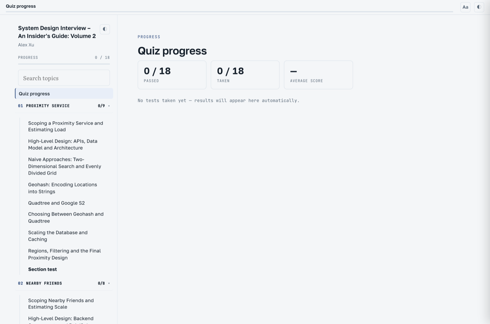
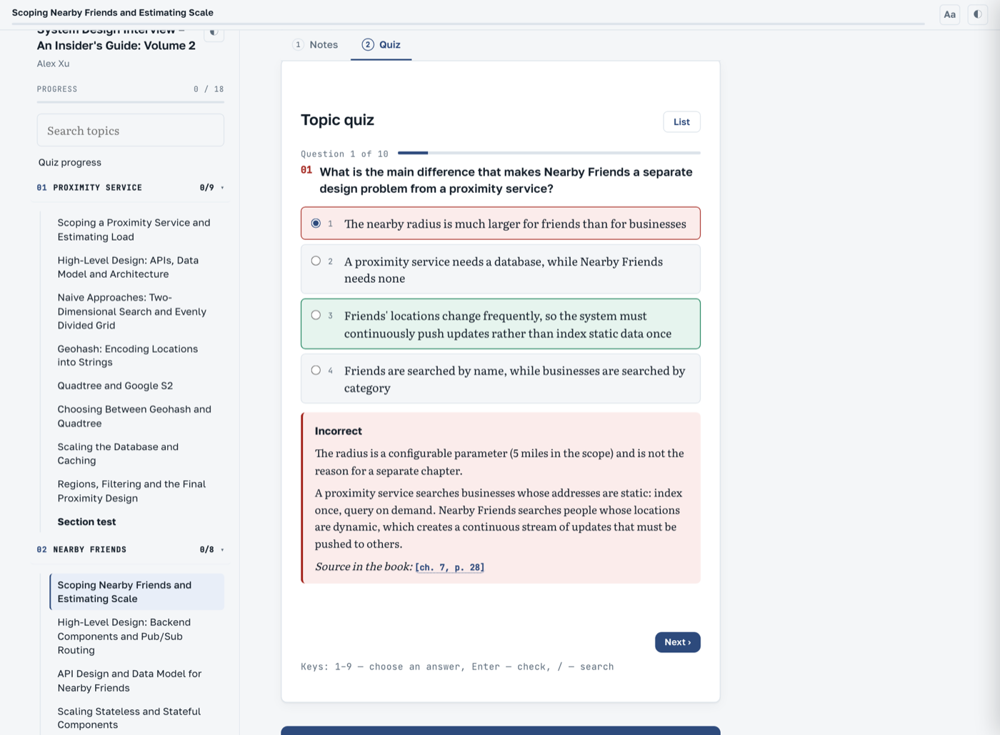
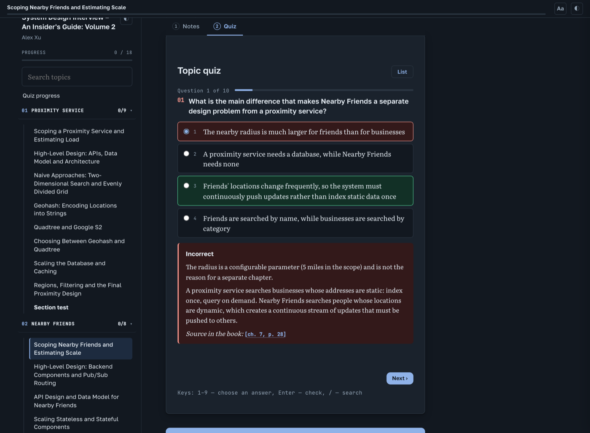
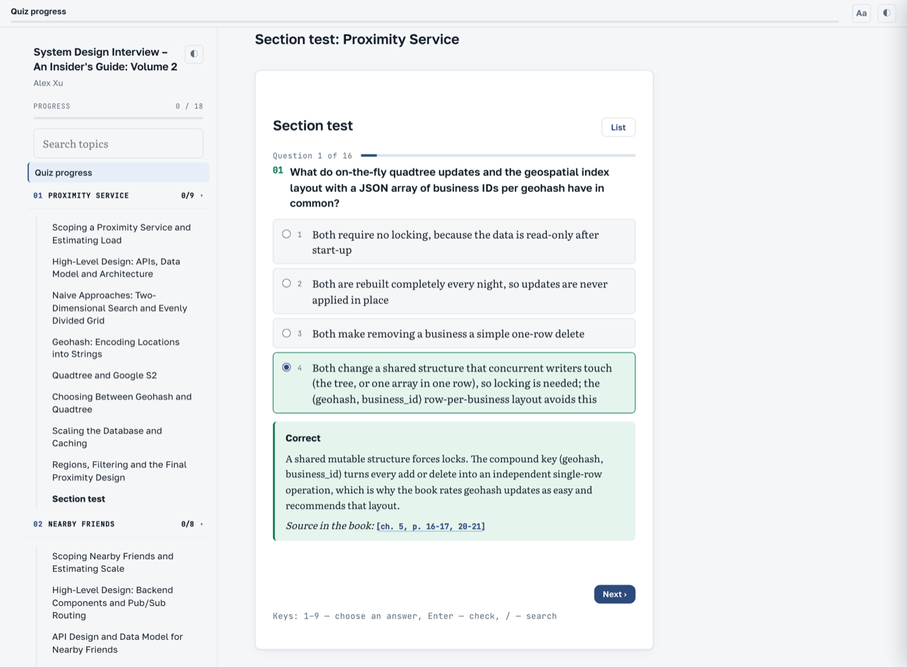
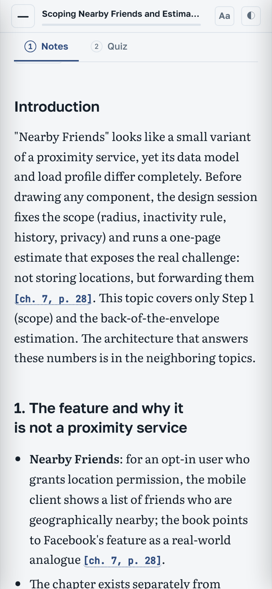
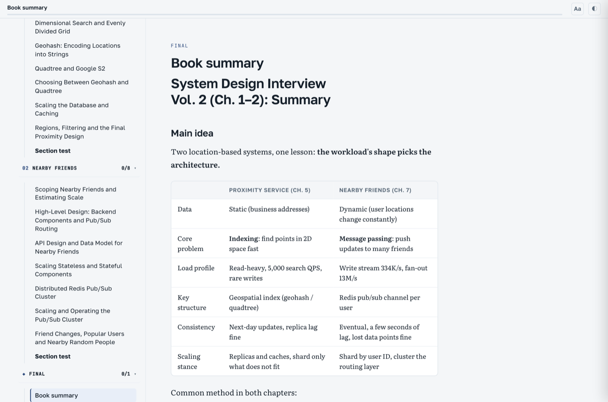
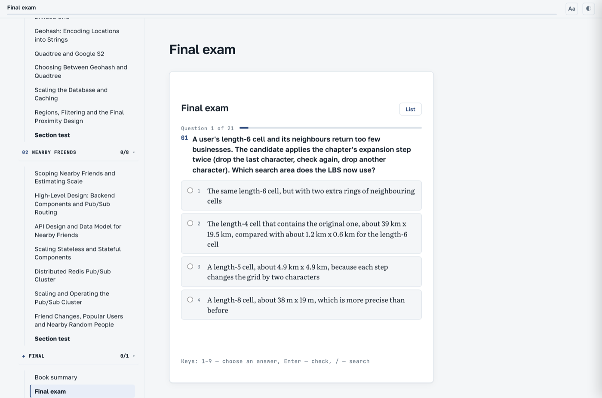
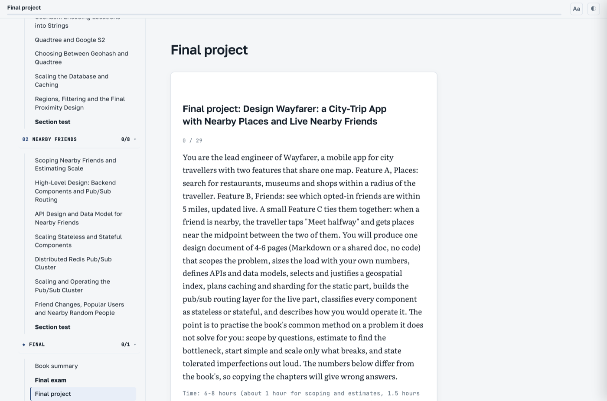

# book-to-textbook

> A Claude Code workflow that turns an epub/pdf book into an interactive HTML textbook — per-topic notes and quizzes, section tests, a final exam. Runs locally, publishes nothing.

An agent for Claude Code that converts a book (epub or pdf) into an **interactive HTML textbook**, entirely on your own machine. Nothing is uploaded anywhere.

What you get from a ~50-topic book:
- notes for every topic (with the book's figures and diagrams, `[ch. N]` references back to the original);
- a quiz per topic: 5–10 multiple-choice questions, each with an explanation of why every option is right or wrong and a pointer to the place in the book;
- a test per section that targets the links between topics;
- a final exam (20–30 questions), a book summary and an end-to-end project (if the book is hands-on);
- a single `textbook.html`: tabs for Full text / Notes / Tests, progress saved in the browser, a topic counts as passed at ≥80%.

## Demo

Built with this workflow from two chapters of *System Design Interview – An Insider's Guide, Vol. 2* (Alex Xu): 15 topics, 2 section tests, a final exam and a project. Language: English. The book itself is not included in the repository, and the frames below show none of its figures — only what the tool generates.

| | |
|---|---|
|  | ![Notes with a comparison table and [ch. N, p. X] references](docs/screenshots/02-notes.png) |
| Overview: sections, topics, progress | Notes: tables, `[ch. N, p. X]` references back to the book |
|  |  |
| Quiz: every option is explained, with a pointer to the book | Dark theme (follows the system setting) |
|  |  |
| Section test: questions across topics | Phone layout |
|  |  |
| Book summary | Final exam (21 questions) |
|  | |
| Final project | |

## Requirements
- Claude Code with the **Workflow** tool (workflows that run subagents). Without it the pipeline cannot start.
- `python3` (epub extraction and the build use only the standard library; PDFs also need `pip3 install pypdf`).
- A book in epub or pdf. PDFs must have bookmarks (a table of contents) — chapters are cut along them. For mobi/azw3, convert to epub first (Calibre: `ebook-convert book.mobi book.epub`).
- Use a copy of the book you are legally entitled to; the output is meant for personal study.

## Install

**Option 1 — work directly in this repository:**
```bash
git clone git@github.com:ablazhey/book-to-textbook.git
cd book-to-textbook && claude
```
Courses are created in `courses/` (git-ignored, so they never end up in the repository).

**Option 2 — add it to your own project:**
```bash
./install.sh ~/my-books        # copies .claude/ into the given folder
cd ~/my-books && claude
```
Or by hand: copy the `.claude/` folder into the root of any project.

## Usage
```
/make-book ~/Downloads/some-book.epub              # textbook language = the language you chat in
/make-book ~/Downloads/some-book.pdf en --auto    # don't pause for confirmation after the pilot
```
What happens:
1. The skill extracts the chapters (`courses/<slug>/chapters`, `images`).
2. It builds a sections → topics map (`map.json`).
3. It runs a **pilot** on two topics and shows you `textbook.html`, the token spend and a forecast for the whole book. You say "continue" (or "shorter", "more examples" — the correction becomes a rule for all remaining topics).
4. It goes through the sections in batches, recovering from failures on its own, then runs the section tests and the final stage.
5. It builds `courses/<slug>/textbook.html` and opens it.

## Cost
A lot. Four agents work on every topic (author, critic, quiz writer, quiz critic), plus rework passes. In our runs that came to roughly **0.5–2 million subagent tokens per topic** including retries, so a 50-topic book costs **tens of millions of tokens**. This is an estimate, not a guarantee — the pilot prints the real figure. For reference, the 15-topic demo above (map, 15 topics, 2 section tests, final stage) used about 6.9 million subagent tokens. If your plan has a tight limit, start with a short book or stop after the pilot.

## Good to know
- **Failures are normal.** Dropped connections kill some agents in every run; the skill resumes the workflow until the whole batch has converged (3–6 resumes per batch is typical). Don't let the computer sleep: agents fail in bulk and a single run can hang for hours. On macOS: `caffeinate -dimsu -t 28800`.
- **Quality.** The critics check every note and quiz against the original and caught many real errors in our runs (mixed-up numbers, invented details, retelling of neighbouring topics). But if a critic itself fails, its check is silently counted as passed, so for important courses skim at least the pilot topics yourself.
- **Language.** The textbook text is written in the language you ask for. The page interface follows `courses/<slug>/course.json` (`{"lang":"en"}` or `{"lang":"ua"}`; any other language falls back to English).
- **Edit the workflow scripts between sessions, not during one.** The Workflow tool snapshots named workflows when the session starts, so edits made mid-session are ignored by `name:` launches. Launch by `scriptPath` (the skill does) or restart the session after changing a script.
- **Fonts.** The page loads Google Fonts when online and falls back to system fonts offline.
- **Course layout** (`courses/<slug>/`): `chapters/`, `images/`, `toc.json`, `map.json`, `topics/` (`.material.md`, `.quiz.json`), `sections/`, `final/`, `textbook.html`. To share a finished book, send the whole folder (or `textbook.html` together with `images/`).

## What's inside
```
.claude/skills/make-book/SKILL.md       the agent: drives every stage and recovers from failures
.claude/workflows/book-map.js           sections and topics map
.claude/workflows/book-topics.js        notes + quiz for every topic (authors and critics)
.claude/workflows/book-section-test.js  section test
.claude/workflows/book-final.js         summary, exam, final project
.claude/workflows/book-trim.js          (optional) shorten notes that came out over budget
.claude/workflows/book-translate.js     (optional) full chapter translation with a glossary
.claude/workflows/scripts/              extract_epub.py, extract_pdf.py, build_textbook.py
install.sh                              copies all of the above into your project (option 2)
```
